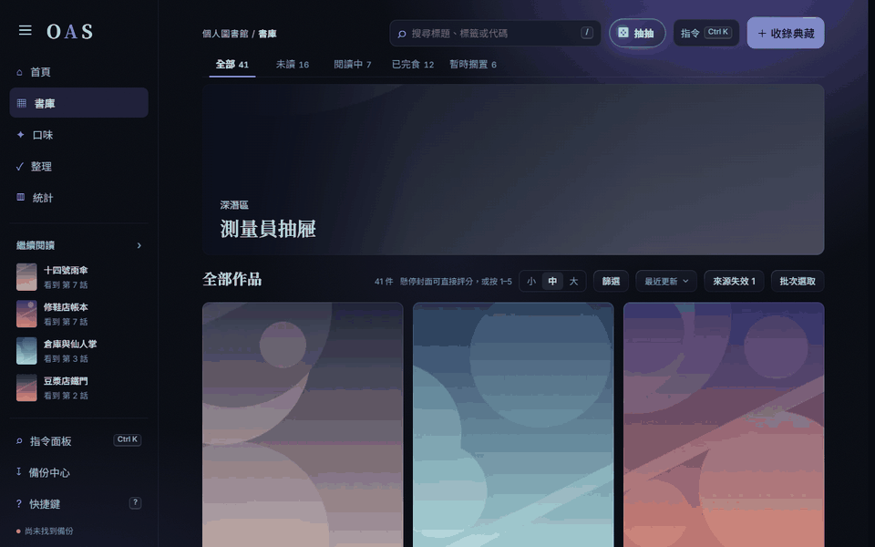
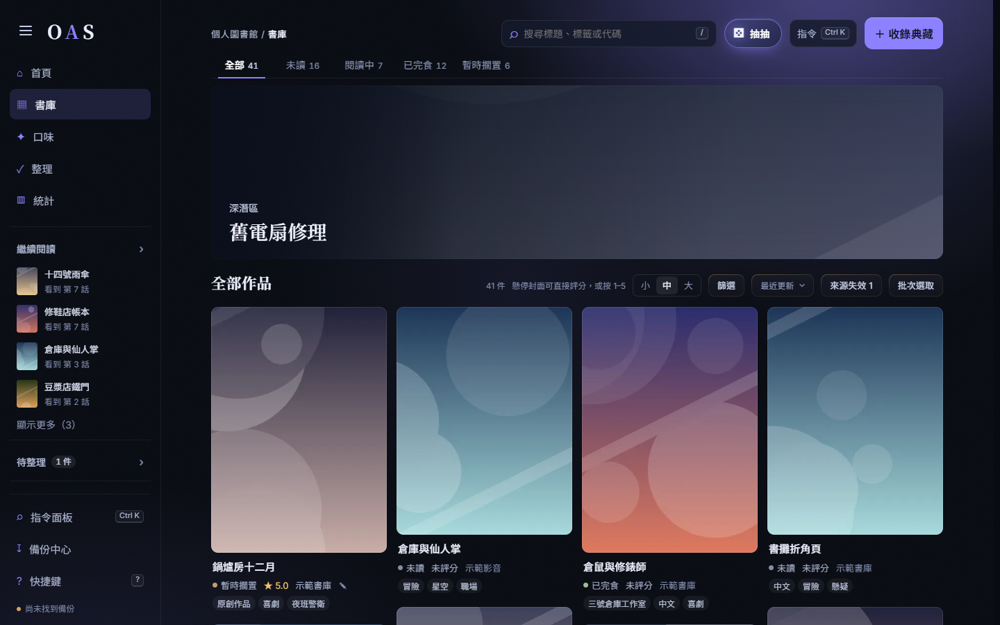
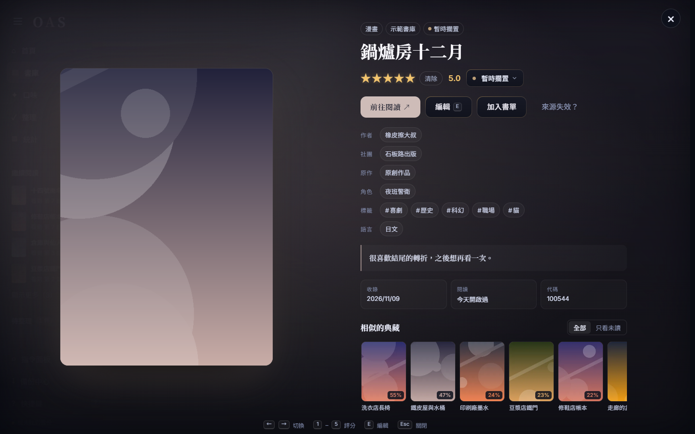
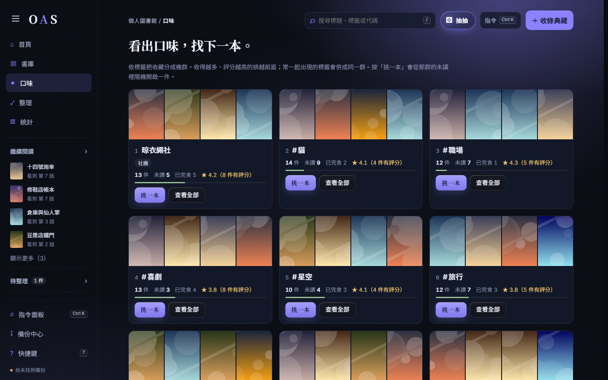
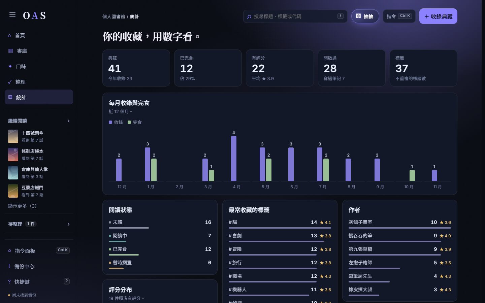

<div align="center">


# OAS 典藏館

**收藏連結，不收藏作品。**<br>
線上漫畫、同人誌、動畫與影片（含成人向）的個人典藏：貼上網址，標題、封面、標籤自動補好。

[下載](../../releases) · [截圖](#截圖) · [常見問題](#常見問題) · [English](#english)


 



</div>

> [!WARNING]
> 你收錄的網站可能含成人內容，本專案僅供成年人使用，請遵守當地法律與各網站的使用條款。本專案不包含任何作品或網站資料；畫面截圖與動圖全部使用虛構的示範資料。**嚴禁用於收錄或管理任何涉及未滿 18 歲者的性相關內容。**

## 特色

- **🔒 資料只在你的電腦上**：不用帳號、沒有伺服器、沒有遙測，資料不經過任何公司。作品留在原網站，典藏館只記網址、標題、標籤和你的紀錄。
- **🔗 貼網址就收錄**：標題、封面、作者、社團、原作、角色與標籤自動補上，英文標籤轉成繁體中文；一次貼幾百個網址也行，在背景慢慢補。
- **📖 記得看到哪、看出口味**：評分、閱讀進度、筆記；依標籤、作者、評分找作品，看相關作品、口味地圖，或從未讀裡挑一本。
- **📱 手機也能用**：Android 測試版把同一套程式直接裝在手機裡，在瀏覽器或其他 App 按「分享」選 OAS 就能收錄。

## 下載

**Windows 10／11**：到 [Releases](../../releases) 下載 `OAS-v<版本>-windows-x64.zip`，解壓縮後雙擊 **`開啟 OAS.cmd`**。不需要另外安裝 Python 或 Node.js，需要 Google Chrome 或 Microsoft Edge。

第一次開啟會先請你確認已滿 18 歲，並選擇封面要不要存在這台電腦（之後可在「整理 → 維護」更改）。典藏館以獨立視窗開啟；關閉視窗後會自動備份並結束服務。想要桌面捷徑，可在 `tools\create-shortcut.ps1` 上按右鍵 →「用 PowerShell 執行」。

**Android 10 以上（arm64，測試版）**：沒有上架商店，APK 放在 [Releases](../../releases) 標示為 Pre-release 的版本裡，檔名是 `OAS-v<版本>-android-arm64.apk`。第一次啟動要確認已滿 18 歲，並自己選擇要不要把封面存到手機、要不要開啟[背景讀取](#讀取作品資料)。

> [!IMPORTANT]
> 手機的備份放在 App 的私有空間（離開 App 時有變動就自動備份，保留最近 10 份）。**解除安裝會連這些備份一起刪除**，手機的雲端備份與換機轉移也不會帶走資料。
>
> **想留下來**：到「整理 → 維護」按「開啟備份中心」，再按「選資料夾並匯出」（選過資料夾之後是「匯出完整備份」），存到自己選的資料夾（例如「下載」或雲端硬碟的資料夾）。匯出的檔案在解除安裝後仍會留著，換手機時在備份中心按「選擇備份檔」還原。匯出的檔案沒有加密，別人拿到就看得到你的收藏清單，請放在安全的地方。

<details>
<summary>安裝方式、自動更新與核對簽署</summary>

- **直接安裝**：用手機下載 APK，打開後依畫面允許「安裝不明應用程式」。之後有新版要自己再下載一次，覆蓋安裝，資料會保留。
- **用 [Obtainium](https://github.com/ImranR98/Obtainium) 自動更新（建議）**：在 Obtainium 新增應用程式，網址填這個 repo 的 GitHub 網址，並開啟「包含預發行版本」（Include prereleases），它就會從 Releases 安裝並通知新版。
- **核對簽署**：正式 APK 的簽署憑證 SHA-256 指紋是 `8f21613b7ff5d16d22c4c7637f9d12a18a0365783dffdcd055da1f252edca2e6`（repo 裡的 `android/release-cert-sha256.txt`）。可用 `apksigner verify --print-certs` 或 AppVerifier 這類 App 核對；不一樣就不要安裝。Release 也附了 APK 的 `.sha256`。

</details>

<details>
<summary>從原始碼執行</summary>

需要 [Python](https://www.python.org/downloads/) 3.11～3.13 與 [Node.js](https://nodejs.org/) LTS。下載原始碼後執行 `tools\create-shortcut.ps1` 建立捷徑，第一次開啟會自動建立執行環境並打包網頁（約一兩分鐘），接著一樣會先確認年齡、選擇封面存不存。

</details>

## 截圖

| 書庫 | 作品展示頁 |
|---|---|
| [](docs/screenshots/gallery.png) | [](docs/screenshots/showcase.png) |
| **口味地圖** | **統計** |
| [](docs/screenshots/taste.png) | [](docs/screenshots/stats.png) |

想自己試試看：`python tools/make_demo.py <資料夾>` 會產生一份虛構的示範典藏館，再以 `OAS_DATA_DIR=<資料夾>` 啟動即可。

## OAS 不做什麼

- 不提供、不下載、不轉存作品，也沒有內建閱讀器。作品一律在原網站閱讀，本專案和任何網站沒有關聯。
- 不破解付費內容，也沒有破解驗證碼的程式；要你操作的驗證不會處理，讀不到的頁面就交給你自己。
- 不收費、沒有廣告，不會把你的資料傳給開發者；讀取作品資料、封面與檢查連結時會連到那些網站。
- 手機版可選的背景讀取，會讓不需要操作的自動驗證照常通過，網頁上的廣告或統計服務也可能一起連線，見[讀取作品資料](#讀取作品資料)。

<details>
<summary><b>適合誰、和其他做法有什麼不同</b></summary>

- 常在線上看漫畫、同人誌、動畫或影片，作品散在好幾個網站，書籤亂成一團的人。
- 想記住看過什麼、看到第幾話、喜不喜歡，但不想下載作品、也不想架伺服器的人。
- 想從自己的評分看出口味，找到下一本要看什麼的人。

| | 瀏覽器書籤 | 下載型管理工具 | OAS |
|---|---|---|---|
| 作品檔案 | 不存 | 存在自己的硬碟 | 不存，留在原網站 |
| 標題、封面、標籤 | 只有網頁標題 | 依工具而定 | 自動補上；封面圖片存不存由你選 |
| 閱讀進度與評分 | 沒有 | 多半有 | 有 |
| 口味分析與相關作品 | 沒有 | 依工具而定 | 有 |
| 失效連結 | 點了才知道 | 不適用 | 定期檢查並標出來 |
| 硬碟空間 | 幾乎不佔 | 很多 | 不多：資料，加上選擇存下的封面圖片（每張最大 10 MB） |

</details>

<details>
<summary><b>完整功能</b></summary>

- **不存作品**：封面圖片要不要存在本機，第一次啟動時由你選，之後也能改。記憶體約 100 MB。
- **貼網址就收錄**：一次貼上數百個網址也行，在背景依網站控制頻率慢慢補，關掉再開會接著補。
- **閱讀紀錄**：未讀、閱讀中、已完食等狀態，0.5 星評分，看到第幾話；從外部網站看完回來時，順手評分。
- **標籤整理**：依網站抓作者、社團、原作、角色等分類；英文標籤自動轉繁體中文；同義詞、封鎖清單、合併與刪除都能復原；「標籤健檢」找出分類可能錯誤或沒用到的標籤。
- **找得到**：搜尋會拆詞，簡體、繁體都找得到，最相符的排最前面；可依標籤、網站、狀態、評分等條件篩選。
- **看出口味**：首頁推薦、口味地圖、相關作品、統計、作者資料頁，以及「挑一本未讀」。
- **整理收藏**：書單與智慧書單、批次編輯、重複作品偵測（標題、網址、封面相同），所有修改都能復原。
- **照顧舊收藏**：定期巡檢來源，標出已失效的連結，並能到其他網站找同一本、一鍵改用新來源。
- **備份**：關閉時自動備份（保留最近 14 份），也能隨時下載完整備份、合併或取代還原。備份不含封面圖片，還原後會再向來源網站取得。

</details>

<details>
<summary><b>相關作品怎麼找</b></summary>

打開一件作品，下方會列出內容最接近的作品，並標上相似度百分比。

- **越少見的標籤越有分量**：大家都有的標籤（超過三成作品都有）和只出現一次的標籤不算；越少見的共同標籤，越能代表兩件作品真的像。
- **不同種類的標籤份量不同**：同一部原作最重，角色、作者次之，社團最輕。
- **標籤多不等於跟誰都像**：會依標籤總量校正，標籤特別多的作品不會到處都排第一。
- **權重不是憑感覺定的**：用「藏起一半標籤，看能不能把相似作品找回來」的模擬反覆測試，再用答案已知的合成資料確認方法沒有選錯，才選出最穩定的參數。
- 只列相似度 4% 以上的前 12 件，也可以只看未讀。

</details>

## 讀取作品資料

貼上作品頁網址，就會讀取標題、代表圖與標籤，能辨識的還會分出作者、社團、原作、角色；讀不到時，可以在作品頁使用「收錄到 OAS」書籤，或自己填寫。請只收錄你有權存取的內容，並遵守各網站的使用條款。

<details>
<summary><b>手機的背景讀取（選用，第一次啟動時自己選）</b></summary>

有些網站用一般連線讀不到。開啟後，收錄或補資料時，App 會在看不到的瀏覽器（系統的 WebView，1 像素、完全透明）裡打開作品頁，一次一頁、不載圖片，把頁面結構交給手機裡的程式解析。之後可在「整理 → 維護」更改。

- 它用 WebView 預設的身分，不偽裝成別的瀏覽器，也不會替你點按任何東西。
- 不需要操作的自動驗證，會像一般瀏覽器一樣照常通過；要你操作的（勾選、驗證碼、登入）不會處理，那一件通常就讀不到；少數驗證或登入頁可能被當成內容，讀到的標題不對時請自己改。
- 網站看到的是你手機的連線。網頁自己的程式會執行，廣告或統計服務可能一起連線；公開版不接受第三方 cookie。網站留下的 cookie 與暫存檔放在 App 的私有空間，關閉背景讀取時會清掉 cookie，解除安裝時全部刪除。
- 這樣讀取是否符合某個網站的條款，要由你自己判斷；不想要就把它關掉。

</details>

## 家裡其他裝置也能看（選用，預設關閉）

Windows 版可以開「區網模式」，讓家裡的手機、平板或另一台電腦用瀏覽器連到這台電腦的典藏館。**預設關閉，不開就和以前一樣只有這台電腦能用。** 開之前請先看完下面的風險：**只在家裡的私人網路開，連線沒有加密。**

<details>
<summary><b>怎麼開啟</b></summary>

資料只存在這台電腦，其他裝置只是遠端操作；電腦要開著典藏館，其他裝置才連得到。

1. 到「整理 → 其他裝置」，看完風險說明、勾選確認後開啟區網模式，再關掉典藏館視窗重新打開。
2. 按「設定防火牆」執行 `tools\enable-lan-firewall.ps1`（要系統管理員權限）。它只建一條規則：TCP 8080、只在「私人」網路、只接受同一個子網路。
3. 按「新增裝置」，在手機上掃 QR 或開網址，輸入 8 位數配對碼（5 分鐘內有效、只能用一次）。
4. 每台裝置可設「標準」或「唯讀」，隨時可以撤銷。還原或下載備份、清除封面、改來源規則、匯入標籤包、管理裝置、開關區網模式，永遠只有這台電腦能做。

</details>

<details open>
<summary><b>區網模式的風險</b></summary>

- **只在家裡的私人網路開。** 咖啡廳、公司、宿舍、飯店這類公用網路不要開。
- **連線沒有加密。** 家用區網沒辦法用一般的加密連線（HTTPS），同一個 Wi‑Fi 裡的人有機會偷看內容或盜用登入。發現不對就撤銷那台裝置，它會立刻失效。
- **家裡每台裝置都看得到配對頁。** 沒有配對碼進不來，但它們知道這台電腦開著典藏館。配對碼猜錯 5 次就作廢。
- **不要同時開代理或埠轉送。** 典藏館把「來自這台電腦本機」的連線當成你本人：代理軟體的「允許區網連線」、`netsh interface portproxy`、`ssh -L`、WSL／Docker 的埠轉送都會讓連線不用配對就能做所有事。路由器也不要轉送 8080 埠。
- **防火牆規則會一直開著。** 規則以埠為準，不管典藏館有沒有開；不用時在「其他裝置」關閉並移除規則，或執行 `tools\enable-lan-firewall.ps1 -Remove`。
- **只在同一台路由器底下有效。** 電腦直接接數據機撥號、手機用行動網路或訪客網路時連不到。

不用時：關閉區網模式並重開典藏館，需要的話按「全部撤銷」，再移除防火牆規則。

</details>

## 隱私與安全

- **資料只在你的裝置上**：資料庫、封面、備份都在本機（Windows 預設 `%LOCALAPPDATA%\OAS`），沒有任何遙測或上傳。選了不存封面時只留網址，封面圖片不存進本機。封面、預覽圖一律由本機的程式抓，畫面不直接連外部網站。
- **預設只開放本機**：服務只聽 `127.0.0.1`，同一網路的其他裝置連不進來；典藏館的 API 只接受自己的網頁：你瀏覽的其他網站無法在背景讀取或修改典藏，也不能叫它去抓圖片。自己開啟區網模式後，家裡的裝置要先用配對碼配對才能連。
- **對網站友善**：只讀取作品頁，依網站控制請求頻率（部分網站每 6 秒一件），被限流就暫停。沒有破解驗證碼或繞過登入的程式。
- **手機版**：資料放在 App 的私有空間；另外要通行碼，手機上的其他 App 也連不進來。背景讀取一次一頁，批次時每頁之間至少休息 1.5 秒。

## 常見問題

<details>
<summary>要註冊或付費嗎？</summary>

都不用。OAS 是免費的開源軟體（MIT 授權），沒有帳號，也沒有廣告。

</details>

<details>
<summary>和下載型的管理工具有什麼不同？</summary>

OAS 不下載作品，只記錄連結與資料，適合在網站上直接閱讀的漫畫與影片。如果你想管理已經下載的檔案，可以看看 LANraragi、Stash 這類工具。

</details>

<details>
<summary>封面要存還是不存？</summary>

存：看得快，來源移除圖片後仍看得到，圖片會留在本機。不存：只留網址，封面每次向來源網站載入，沒有網路或來源移除圖片時就看不到。之後可在「整理 → 維護」更改；改成不存時，可以選擇刪掉已經存下的封面。

</details>

<details>
<summary>資料存在哪裡？要怎麼搬到別台電腦？</summary>

預設在 `%LOCALAPPDATA%\OAS`（可用環境變數 `OAS_DATA_DIR` 改位置）。最簡單的方式是在「備份中心」下載完整備份，到新電腦用「還原」匯入。

</details>

<details>
<summary>標籤是簡體或英文的怎麼辦？可以加自己的翻譯嗎？</summary>

全新安裝會附上入門翻譯包（常見英文標籤轉繁體中文）。之後在「整理 → 標籤健檢」合併標籤時會自動記成同義詞，以後再抓到就會自動換成你整理後的名稱。

也可以加自己的翻譯：第一次啟動後，資料夾（預設 `%LOCALAPPDATA%\OAS`）裡會有一個空的 `tag_pack_private.json`，照裡面的說明寫入「原文: 譯名」，重新啟動就會套用。入門翻譯包只有一般標籤，作品名、角色名可以寫在這裡。這個檔案只有你有，更新版本不會動到。

</details>

<details>
<summary>某個網站一直讀不到？</summary>

可能被網站限流或有防護。背景作業會自動暫停那個網站、稍後再試；有防護的網站，請改用「收錄到 OAS」書籤，或自己填寫。

手機可以開啟背景讀取。

</details>

<details>
<summary>可以從其他裝置連進來嗎？</summary>

Windows 版可以自己開啟區網模式（預設關閉），讓家裡的裝置配對後用瀏覽器連進來，見[家裡其他裝置也能看](#家裡其他裝置也能看選用預設關閉)。只在家裡的私人網路用。各台電腦的典藏館資料是獨立的，要搬資料就用備份檔還原或合併。

Android 另有測試版，直接裝在手機上，見[下載](#下載)；iPhone 沒有。

</details>

## 開發

<details>
<summary>架構與開發環境</summary>

```
backend/              FastAPI + SQLAlchemy（SQLite）
  app/main.py         建立 app、啟動流程、掛上防護與各組 API
  app/routers/        作品、書單、標籤、分析、來源與備份、背景作業
  app/scheduler.py    背景工作排程：工作存在資料庫，關掉再開會接著做
  app/fetcher.py      依網站控制請求頻率與限流冷卻
  app/frontend.py     直接提供打包好的網頁
  tests/              pytest
frontend/             React 19 + Vite
tools/                啟動器、捷徑建立、區網模式的防火牆設定、示範資料、免安裝版打包
android/              Android 外殼（Chaquopy 在手機裡跑同一套後端）
```

需要 Python 3.11～3.13 與 Node.js LTS。

```powershell
cd backend
python -m venv .venv
.venv\Scripts\pip install -r requirements-dev.txt
.venv\Scripts\python -m pytest -q
.venv\Scripts\python -m uvicorn app.main:app --port 8080 --reload

# 另開一個視窗：/api 轉給 8080 埠（和桌面捷徑同一埠，兩者不要同時開）
# 後端用其他埠時，先設 $env:OAS_API_URL = "http://localhost:8000"
cd frontend
npm ci
npm run dev
```

打包免安裝版：`python tools/build_portable.py`（輸出到 `dist/`）。

</details>

## 授權

[MIT](LICENSE)。第三方軟體的授權見 [THIRD_PARTY_NOTICES.md](THIRD_PARTY_NOTICES.md)。

---

<a id="english"></a>
## English

**OAS keeps links, not works.** A local-first personal catalogue for manga, doujinshi, anime and videos you read or watch on the web. For adults only (18+); the UI is in Traditional Chinese. MIT licensed.

- **Local-first**: no account, no server, no telemetry. It stores links and metadata — title, tags, reading status, rating, progress — never the works themselves. On first launch you confirm you are 18+ and choose whether cover images are saved locally.
- **Paste a link, get the details**: title, cover and tags are fetched in the background with per-site rate limiting; English tags are translated.
- **Know your taste**: ratings, progress, duplicate detection, dead-link checks, undo for every change, and related works ranked by shared rare tags (weights tuned by hiding half of each work's tags and measuring recovery).

**Download**: Windows portable build from Releases — unzip and double-click `開啟 OAS.cmd`.
An Android test build (Android 10+, arm64) is a pre-release: install the APK directly, or track this repo in Obtainium with pre-releases enabled. Signing certificate SHA-256 `8f21613b7ff5d16d22c4c7637f9d12a18a0365783dffdcd055da1f252edca2e6`. It can optionally read work pages in a hidden WebView, where automatic checks that need no interaction pass as in a normal browser, while anything that needs you to act is left alone; you choose this on first launch and can turn it off. Uninstalling deletes its in-app backups; to keep them, export a backup to a folder you choose (整理 → 維護 → 開啟備份中心) — the exported file is not encrypted, so keep it somewhere safe.

**Optional LAN mode** (Windows, off by default): other devices at home can pair with an 8-digit code and use the catalogue in a browser. Use it only on a private home network — traffic is not encrypted, and proxies or port forwarding on the same PC bypass pairing. Restore, backup download and device management stay limited to the PC itself.
