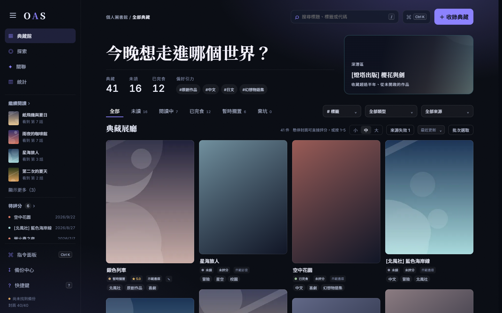
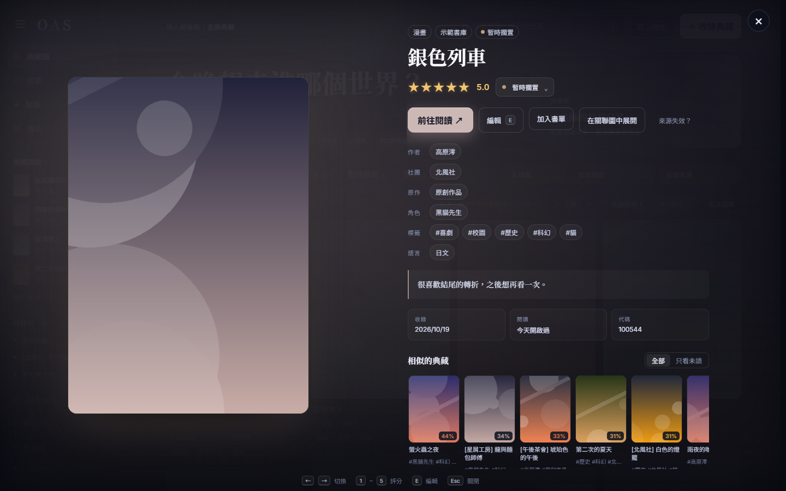
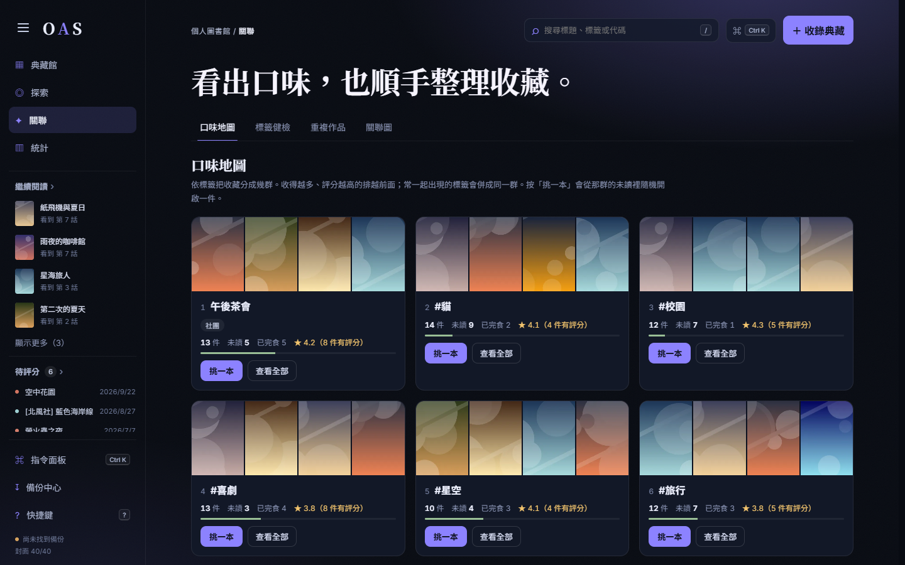
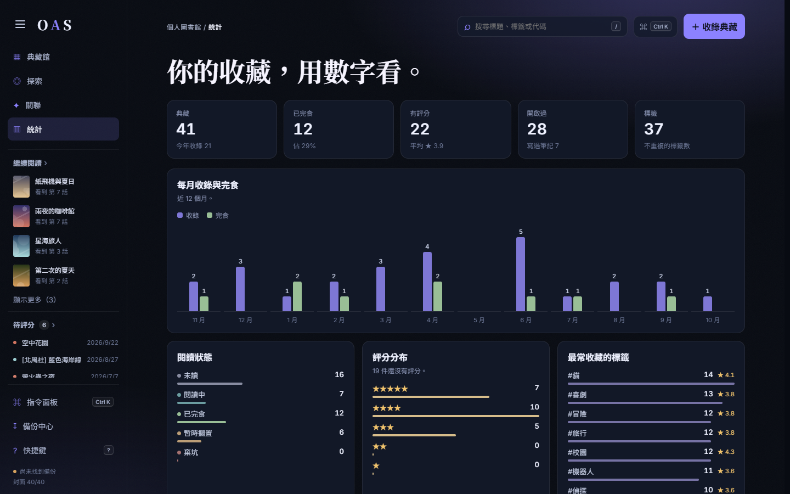

<div align="center">


# OAS 典藏館

**收藏連結，不收藏檔案。** 本機優先的個人作品典藏：記下你在各網站看過、想看的作品，<br>
自動補上標題、封面與標籤，整理閱讀進度與評分，看出自己的口味。

[下載免安裝版](../../releases) · [截圖](#截圖) · [安裝與使用](#安裝與使用) · [常見問題](#常見問題) · [English](#english)

   

</div>

> [!WARNING]
> 部分支援的網站含成人內容，僅供成年人使用，請遵守當地法律與各網站的使用條款。本專案不包含任何作品或網站資料；畫面截圖全部使用虛構的示範資料。

## 能做什麼

- **只存連結和資料**：作品留在原網站，典藏館只記標題、封面、標籤和你的紀錄，幾乎不佔硬碟空間；記憶體約 100 MB。
- **貼網址就收錄**：自動讀取標題、封面與標籤；一次貼上數百個網址也行，在背景依網站控制頻率慢慢補，關掉再開會接著補。
- **閱讀紀錄**：未讀、閱讀中、已完食等狀態，0.5 星評分，看到第幾話；從外部網站看完回來時，順手評分。
- **標籤整理**：依網站抓作者、社團、原作、角色等分類；英文標籤自動轉繁體中文；同義詞、封鎖清單、合併與刪除都能復原；「標籤健檢」找出分類可能錯誤或沒用到的標籤。
- **看出口味**：口味地圖、相似作品、關聯圖、統計、作者資料頁，以及「挑一本未讀」。
- **整理收藏**：書單與智慧書單、批次編輯、重複作品偵測（標題、網址、封面相同），所有修改都能復原。
- **照顧舊收藏**：定期巡檢來源，標出已失效的連結，並能到其他網站找同一本、一鍵改用新來源。
- **備份**：關閉時自動備份（保留最近 14 份），也能隨時下載完整備份、合併或取代還原。

## 截圖

| 典藏館 | 作品展示頁 |
|---|---|
| [](docs/screenshots/gallery.png) | [](docs/screenshots/showcase.png) |
| **口味地圖** | **統計** |
| [](docs/screenshots/taste.png) | [](docs/screenshots/stats.png) |

想自己試試看：`python tools/make_demo.py <資料夾>` 會產生一份虛構的示範典藏館，再以 `OAS_DATA_DIR=<資料夾>` 啟動即可。

## 安裝與使用

### Windows 免安裝版（建議）

1. 到 [Releases](../../releases) 下載 `OAS-v<版本>-windows-x64.zip`，解壓縮到任意資料夾（例如「文件」）。
2. 雙擊資料夾裡的 **`開啟 OAS.cmd`**；想要桌面捷徑，可在 `tools\create-shortcut.ps1` 上按右鍵 →「用 PowerShell 執行」。
3. 典藏館以獨立視窗開啟；關閉視窗後會自動備份並結束服務。

不需要另外安裝 Python 或 Node.js。需要 Google Chrome 或 Microsoft Edge。

### 從原始碼執行

需要 [Python](https://www.python.org/downloads/) 3.11 以上與 [Node.js](https://nodejs.org/) LTS。下載原始碼後執行 `tools\create-shortcut.ps1` 建立捷徑，第一次開啟會自動建立執行環境並打包網頁（約一兩分鐘）。

### Docker

`docker compose up --build -d`，開啟 `http://localhost:8080`。資料存在 Docker 磁碟區 `oas-next_oas-data`。

## 支援的網站

| 網站 | 讀取方式 |
|---|---|
| nhentai、紳士漫畫、Hanime1 | 直接讀取標題、封面與標籤（含作者、社團等分類） |
| 禁漫天堂、MissAV | 有防護，伺服器讀不到；請在作品頁使用「收錄到 OAS」書籤 |
| 其他網站 | 讀取網頁標題與代表圖；可在備份中心自行新增網址規則 |

> [!TIP]
> **看到別人只留下一串「神的語言」？** 那通常是作品編號。N 網的數字**直接貼進收錄框就行**（「一次收錄多個網址」裡一行一個也可以），會自動換成作品頁網址；紳士漫畫的編號放進 `https://www.wnacg.com/photos-index-aid-編號.html`、禁漫的車號接在 `https://18comic.vip/album/` 後面再貼進來（禁漫請到作品頁用書籤收錄）。

## 隱私與安全

- **資料只在你的電腦上**：資料庫、封面快取、備份都在本機（預設 `%LOCALAPPDATA%\OAS`），沒有任何遙測或上傳。
- **只開放本機**：服務只聽 `127.0.0.1`，同一網路的其他裝置連不進來；會改資料的請求只接受典藏館自己的網頁，其他網站無法在背景操作。
- **對網站友善**：只讀取作品頁，依網站控制請求頻率（部分網站每 6 秒一件），被限流就暫停；不實作規避驗證碼、Cloudflare 或其他反自動化機制。

## 常見問題

**和下載型的管理工具有什麼不同？**
OAS 不下載作品，只記錄連結與資料，適合在網站上直接閱讀的漫畫與影片。如果你想管理已經下載的檔案，可以看看 LANraragi、Stash 這類工具。

**資料存在哪裡？要怎麼搬到別台電腦？**
預設在 `%LOCALAPPDATA%\OAS`（可用環境變數 `OAS_DATA_DIR` 改位置）。最簡單的方式是在「備份中心」下載完整備份，到新電腦用「還原」匯入。

**標籤是簡體或英文的怎麼辦？**
全新安裝會附上入門翻譯包（常見英文標籤轉繁體中文）。之後在「關聯 → 標籤健檢」合併標籤時會自動記成同義詞，以後再抓到就會自動換成你整理後的名稱。

**某個網站一直讀不到？**
可能被網站限流或有防護。背景作業會自動暫停那個網站、稍後再試；有防護的網站請改用「收錄到 OAS」書籤。

**可以給手機或其他電腦用嗎？**
目前不行：典藏館沒有登入機制，只開放本機使用。

## 架構

```
backend/              FastAPI + SQLAlchemy（SQLite）
  app/main.py         建立 app、啟動流程、掛上防護與各組 API
  app/routers/        作品、書單、標籤、分析、來源與備份、背景作業
  app/scheduler.py    背景工作排程：工作存在資料庫，關掉再開會接著做
  app/fetcher.py      依網站控制請求頻率與限流冷卻
  app/frontend.py     直接提供打包好的網頁
  tests/              pytest
frontend/             React 19 + Vite
tools/                啟動器、捷徑建立、示範資料、免安裝版打包
```

## 開發

```powershell
cd backend
python -m venv .venv
.venv\Scripts\pip install -r requirements-dev.txt
.venv\Scripts\python -m pytest -q
.venv\Scripts\python -m uvicorn app.main:app --port 8000 --reload

# 另開一個視窗（/api 轉給 8000 埠）
cd frontend
npm ci
npm run dev
```

打包免安裝版：`python tools/build_portable.py`（輸出到 `dist/`）。

## 授權

[MIT](LICENSE)

---

<a id="english"></a>
**English.** OAS is a local-first personal catalogue for works you read or watch on the web. It stores links and metadata — title, cover, tags, reading status, rating, progress — never the works themselves. Features include background metadata fetching with per-site rate limiting, tag categories, synonyms and translation, duplicate detection, dead-link checks, taste analysis and undo for every change. Windows portable build: download from Releases, unzip, double-click `開啟 OAS.cmd`. The UI is in Traditional Chinese. Some supported sites contain adult content (18+). MIT licensed.
