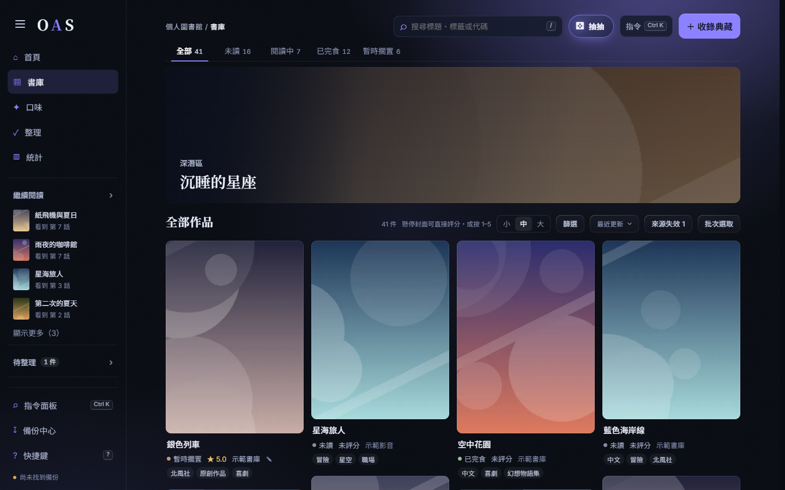
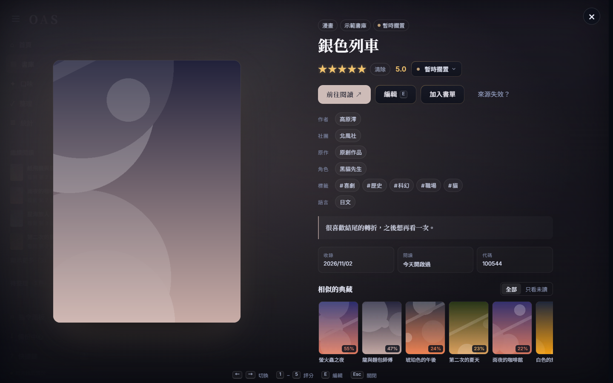
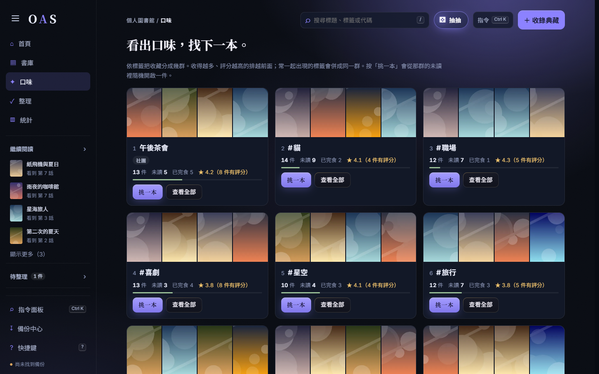
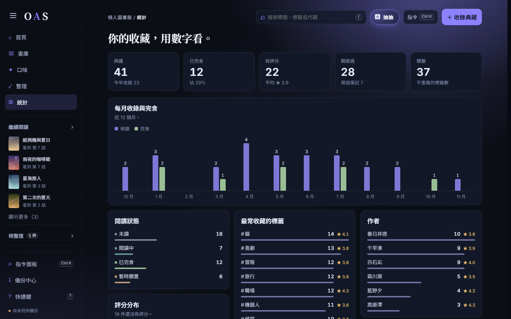

<div align="center">


# OAS 典藏館

**收藏連結，不收藏檔案。** 線上漫畫、同人誌、動畫與影片（含成人向）的個人典藏：<br>
貼上作品網址，自動補上標題、封面與標籤，記下看到哪裡、喜不喜歡，看出自己的口味。

[下載免安裝版](../../releases) · [截圖](#截圖) · [安裝與使用](#安裝與使用) · [常見問題](#常見問題) · [English](#english)

   

</div>

> [!WARNING]
> 你收錄的網站可能含成人內容，本專案僅供成年人使用，請遵守當地法律與各網站的使用條款。本專案不包含任何作品或網站資料；畫面截圖全部使用虛構的示範資料。

## 適合誰

- 常在線上看漫畫、同人誌、動畫或影片，作品散在好幾個網站，書籤亂成一團的人。
- 想記住看過什麼、看到第幾話、喜不喜歡，但不想下載檔案、也不想架伺服器的人。
- 想從自己的評分看出口味，找到下一本要看什麼的人。

## 實際怎麼用

1. **看到想看的作品**：把作品頁網址貼進典藏館，或在作品頁按「收錄到 OAS」書籤；一次貼幾百個網址也可以。
2. **資料自動補好**：標題、封面、作者、社團、原作、角色與標籤會自己填上，英文標籤也會轉成繁體中文，不用手動整理。
3. **想看的時候點開**：作品一律在原網站閱讀。按「前往閱讀」就會打開原本的頁面。
4. **看完回來記一下**：評分、記下看到第幾話、寫筆記。累積久了，就能依標籤、作者、評分找作品，也能看到相關作品、自己的口味地圖，或從未讀裡隨機挑一本。

## 和其他做法有什麼不同

| | 瀏覽器書籤 | 下載型管理工具 | OAS |
|---|---|---|---|
| 作品檔案 | 不存 | 存在自己的硬碟 | 不存，留在原網站 |
| 標題、封面、標籤 | 只有網頁標題 | 依工具而定 | 自動補上 |
| 閱讀進度與評分 | 沒有 | 多半有 | 有 |
| 口味分析與相關作品 | 沒有 | 依工具而定 | 有 |
| 失效連結 | 點了才知道 | 不適用 | 定期檢查並標出來 |
| 硬碟空間 | 幾乎不佔 | 很多 | 很少，只有資料與封面縮圖 |

## OAS 不做什麼

- 不提供、不下載、不轉存作品，也沒有內建閱讀器。
- 不破解付費內容，也不規避驗證碼或其他防護；讀不到的頁面就交給你自己處理。
- 不需要帳號、不收費、沒有廣告，也不會把你的資料傳到任何地方。

**嚴禁用於收錄或管理任何涉及未滿 18 歲者的性相關內容。**

## 能做什麼

- **只存連結和資料**：作品留在原網站，典藏館只記標題、封面、標籤和你的紀錄，幾乎不佔硬碟空間；記憶體約 100 MB。
- **貼網址就收錄**：自動讀取標題、封面與標籤；一次貼上數百個網址也行，在背景依網站控制頻率慢慢補，關掉再開會接著補。
- **閱讀紀錄**：未讀、閱讀中、已完食等狀態，0.5 星評分，看到第幾話；從外部網站看完回來時，順手評分。
- **標籤整理**：依網站抓作者、社團、原作、角色等分類；英文標籤自動轉繁體中文；同義詞、封鎖清單、合併與刪除都能復原；「標籤健檢」找出分類可能錯誤或沒用到的標籤。
- **找得到**：搜尋會拆詞，簡體、繁體都找得到，最相符的排最前面；可依標籤、網站、狀態、評分等條件篩選。
- **看出口味**：首頁推薦、口味地圖、相關作品、統計、作者資料頁，以及「挑一本未讀」。
- **整理收藏**：書單與智慧書單、批次編輯、重複作品偵測（標題、網址、封面相同），所有修改都能復原。
- **照顧舊收藏**：定期巡檢來源，標出已失效的連結，並能到其他網站找同一本、一鍵改用新來源。
- **備份**：關閉時自動備份（保留最近 14 份），也能隨時下載完整備份、合併或取代還原。

## 截圖

| 書庫 | 作品展示頁 |
|---|---|
| [](docs/screenshots/gallery.png) | [](docs/screenshots/showcase.png) |
| **口味地圖** | **統計** |
| [](docs/screenshots/taste.png) | [](docs/screenshots/stats.png) |

想自己試試看：`python tools/make_demo.py <資料夾>` 會產生一份虛構的示範典藏館，再以 `OAS_DATA_DIR=<資料夾>` 啟動即可。

## 安裝與使用

### Windows 免安裝版（建議）

1. 到 [Releases](../../releases) 下載 `OAS-v<版本>-windows-x64.zip`，解壓縮到任意資料夾（例如「文件」）。
2. 雙擊資料夾裡的 **`開啟 OAS.cmd`**；想要桌面捷徑，可在 `tools\create-shortcut.ps1` 上按右鍵 →「用 PowerShell 執行」。
3. 典藏館以獨立視窗開啟；關閉視窗後會自動備份並結束服務。

不需要另外安裝 Python 或 Node.js。需要 Google Chrome 或 Microsoft Edge。

### 從原始碼執行

需要 [Python](https://www.python.org/downloads/) 3.11 以上與 [Node.js](https://nodejs.org/) LTS。下載原始碼後執行 `tools\create-shortcut.ps1` 建立捷徑，第一次開啟會自動建立執行環境並打包網頁（約一兩分鐘）。

## 讀取作品資料

貼上作品頁網址，就會讀取標題、代表圖與標籤，能辨識的還會分出作者、社團、原作、角色；讀不到時，可以在作品頁使用「收錄到 OAS」書籤，或自己填寫。

作品一律留在原網站，本專案不提供任何作品，也和任何網站沒有關聯。請只收錄你有權存取的內容，並遵守各網站的使用條款。

## 隱私與安全

- **資料只在你的電腦上**：資料庫、封面快取、備份都在本機（預設 `%LOCALAPPDATA%\OAS`），沒有任何遙測或上傳。
- **只開放本機**：服務只聽 `127.0.0.1`，同一網路的其他裝置連不進來；會改資料的請求只接受典藏館自己的網頁，其他網站無法在背景操作。
- **對網站友善**：只讀取作品頁，依網站控制請求頻率（部分網站每 6 秒一件），被限流就暫停；不實作規避驗證碼、Cloudflare 或其他反自動化機制。

## 常見問題

**要註冊或付費嗎？**
都不用。OAS 是免費的開源軟體（MIT 授權），沒有帳號，也沒有廣告。

**和下載型的管理工具有什麼不同？**
OAS 不下載作品，只記錄連結與資料，適合在網站上直接閱讀的漫畫與影片。如果你想管理已經下載的檔案，可以看看 LANraragi、Stash 這類工具。

**資料存在哪裡？要怎麼搬到別台電腦？**
預設在 `%LOCALAPPDATA%\OAS`（可用環境變數 `OAS_DATA_DIR` 改位置）。最簡單的方式是在「備份中心」下載完整備份，到新電腦用「還原」匯入。

**標籤是簡體或英文的怎麼辦？**
全新安裝會附上入門翻譯包（常見英文標籤轉繁體中文）。之後在「整理 → 標籤健檢」合併標籤時會自動記成同義詞，以後再抓到就會自動換成你整理後的名稱。

**可以加自己的翻譯嗎？**
可以。第一次啟動後，資料夾（預設 `%LOCALAPPDATA%\OAS`）裡會有一個空的 `tag_pack_private.json`，照裡面的說明寫入「原文: 譯名」，重新啟動就會套用。入門翻譯包只有一般標籤，作品名、角色名可以寫在這裡。這個檔案只有你有，更新版本不會動到。

**某個網站一直讀不到？**
可能被網站限流或有防護。背景作業會自動暫停那個網站、稍後再試；有防護的網站請改用「收錄到 OAS」書籤。

**可以給手機或其他電腦用嗎？**
目前不行：典藏館沒有登入機制，只開放本機使用。

## 架構

```
backend/              FastAPI + SQLAlchemy（SQLite）
  app/main.py         建立 app、啟動流程、掛上防護與各組 API
  app/routers/        作品、書單、標籤、分析、來源與備份、背景作業
  app/scheduler.py    背景工作排程：工作存在資料庫，關掉再開會接著做
  app/fetcher.py      依網站控制請求頻率與限流冷卻
  app/frontend.py     直接提供打包好的網頁
  tests/              pytest
frontend/             React 19 + Vite
tools/                啟動器、捷徑建立、示範資料、免安裝版打包
```

## 開發

```powershell
cd backend
python -m venv .venv
.venv\Scripts\pip install -r requirements-dev.txt
.venv\Scripts\python -m pytest -q
.venv\Scripts\python -m uvicorn app.main:app --port 8000 --reload

# 另開一個視窗（/api 轉給 8000 埠）
cd frontend
npm ci
npm run dev
```

打包免安裝版：`python tools/build_portable.py`（輸出到 `dist/`）。

## 授權

[MIT](LICENSE)。第三方軟體的授權見 [THIRD_PARTY_NOTICES.md](THIRD_PARTY_NOTICES.md)。

---

<a id="english"></a>
**English.** OAS is a local-first personal catalogue for manga, doujinshi, anime and videos you read or watch on the web. It stores links and metadata — title, cover, tags, reading status, rating, progress — never the works themselves. Features include background metadata fetching with per-site rate limiting, tag categories, synonyms and translation, duplicate detection, dead-link checks, taste analysis and undo for every change. Windows portable build: download from Releases, unzip, double-click `開啟 OAS.cmd`. The UI is in Traditional Chinese. For adults only (18+). MIT licensed.
